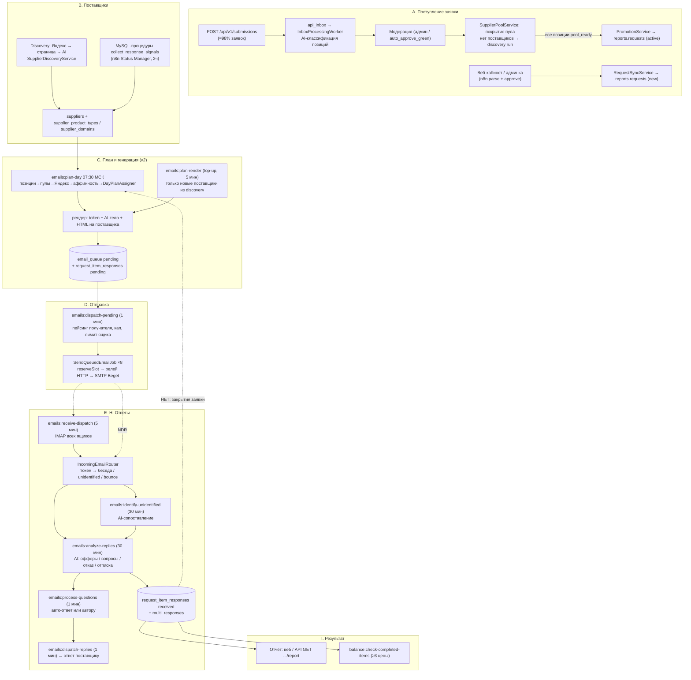

# Карта конвейера: заявка → рассылка → ответы → результат

**Снимок:** 2026-10-14, код `2067230` (локально = прод), флаги и воркеры сняты с прода, цифры — из боевой БД `reports`.
**Назначение:** полная картина «как оно работает на самом деле» перед модернизацией алгоритма и расширением публичного API. Где код расходится с `CLAUDE.md` / `dispatch-planner-design.md` — прав код (расхождения собраны в §15).

Обозначения: `файл:строка` — точка входа; **[прод]** — фактическое значение на проде; ⚠ — дефект/риск (полный реестр в §13).

---

## 0. Сквозная схема



**Главный разрыв:** на конце цикла нет обратного перехода «позиция/заявка закрыта». Планировщик просто перестаёт брать позицию при ≥4 ценах или **заявку целиком старше 7 дней**, а статус заявки навсегда остаётся `active` (§9).

---

## 1. Фактическое состояние прода (2026-10-14)

### 1.1 Объёмы
| Показатель | Значение |
|---|---|
| Источник заявок | `api` 598 / `web` 196 за всё время; с мая 2026 — **почти 100% API** (окт: 34, сен: 161) |
| `requests.status` | active **389**, completed 385, cancelled 16, emails_sent 3, new 1 |
| Последний `completed` | **2026-08-08** — с тех пор ни одна заявка не закрыта |
| Активных заявок старше 7 дней | **375 из 389** — выпали из планировщика (`fresh_days=7`), но висят `active` |
| Позиции активных заявок (1935) по числу поставщиков с ценой | 0 → **1087 (56%)**, 1 → 521, 2 → 170, 3 → 72, 4 → 31, ≥5 → 54. До цели ≥4 дошли **4.4%** |
| `request_items.status` | все 3558 = `pending` (поле мёртвое) |
| `requests.offer_target` / `max_reach` | NULL / 0 у всех активных (берётся дефолт 4) |
| Отправлено писем | июн 84.5k, июл 28.2k, авг 9.5k, сен 27.0k, окт (до 14-го) 9.2k |
| Отклик (`email_queue.replied` / sent) | стабильно **≈8%** |
| План дня (лог `PlanDayCampaign: рендер`) | 07.10: 173, 08.10: 1040, 09.10: 498, 12.10: 1439, 13.10: 869, 14.10: 203 писем; дедуп-скипов ≈0 |
| `request_item_responses` | pending 252k (= «писали»), received 6.6k |
| `email_conversations.status` | **'' 9960** (невалидный enum, легаси n8n до 25.06), waiting 6343, complete 3983, partial 1747, needs_clarification 1428 |
| `unidentified_emails` | **bounce/pending 5416** (никем не обрабатываются), **manual_review 10290** (UI разбора нет), pending 242 |
| `send_intents` | **backlog 63 629** (stale, никто не дренирует), rendered 2569 |
| AI-анализ: тихие провалы (fallback) | 1–3% писем/мес (июл 97, сен 47) — **письмо помечено обработанным пустым** |
| `email_messages` incoming с `ai_processed=0` | 655 |

### 1.2 Флаги `.env` прода (конвейерные)
```
EMAILS_DISPATCH_ENABLED=true      EMAILS_RECEIVE_ENABLED=true     EMAILS_ANALYZE_ENABLED=true
EMAILS_IDENTIFY_ENABLED=true      EMAILS_QUESTIONS_ENABLED=true   EMAILS_REPLIES_ENABLED=true
EMAILS_AUTOCLOSE_ENABLED=true     EMAILS_UNSUBSCRIBE_ENABLED=true ATTACHMENTS_DRIVE_ENABLED=true
EMAILS_GENERATE_ENABLED=false     ← v1 выключен
EMAILS_PLANNER_ENABLED=true       EMAILS_DAYPLAN_ENABLED=true     ← v2 в бою
EMAILS_DAYPLAN_ADAPTIVE_K=true    EMAILS_DAYPLAN_DENSIFY=true     EMAILS_POOL_KARMA_GATE=true
EMAILS_PRETARGET_ENABLED=true (RESULTS=100)                       ← Яндекс в plan-day
EMAILS_POOL_GATE_ENABLED=true     EMAILS_LOAD_DEFER_ENABLED=true  EMAILS_LOAD_CLUSTER_ENABLED=true  ← живут только в v1-пути → фактически инертны
EMAILS_WAVES_V2=false             EMAILS_POOL_FOLLOWUP_ENABLED=false
EMAILS_WARMUP_ENABLED=true        EMAILS_SPAM_GUARD_ENABLED=true  EMAILS_REVIVAL_ENABLED=true (конфига-ключа нет → мёртв)
EMAILS_SEND_VIA_MICROSERVICE=true EMAILS_MICROSERVICE_URLS=[45.146.167.20:8000, 155.212.185.101:8000] (вес 1/1)
EMAILS_RELAY_CHANNELS=[45.146.167.20:465, 155.212.185.101:465]    EMAILS_SMTP_DUAL_ENABLED=false
EMAILS_RECIPIENT_INTERVAL_MIN=1500 (25 мин)  EMAILS_RECIPIENT_INTERVAL_MAX=3600
EMAILS_WORK_WINDOW_END_HOUR=21    EMAILS_WORK_WINDOW_FRACTION=0.8 EMAILS_GLOBAL_MIN_INTERVAL=2
EMAILS_GENERATE_ITEMS_PER_BATCH=8 EMAILS_GENERATE_BODY_TEMP=0.85
QUEUE_CONNECTION=database  CACHE_STORE=database
```
Остальное — дефолты `config/services.php` (не заданы в `.env`): `EMAILS_PLANNER_FRESH_DAYS=7`, `EMAILS_PLANNER_OFFER_TARGET=4`, `EMAILS_DAYPLAN_MAX_PER_EMAIL=4`, `EMAILS_RECIPIENT_DAILY_CAP=10` (5..15 адаптивно). Биллинг: `BILLING_API_RECONCILE_ENABLED=true` на проде (списание API работает с 01.07.2026).

### 1.3 Воркеры (systemd, все `queue:work database`)
| Очередь | Юниты | Что ест |
|---|---|---|
| `emails` | `iqot-email-worker@1..8` **+ ⚠ 9-й юнит с буквальным именем `@{1,2,3,4,5,6,7,8}`** (не раскрылась brace-expansion) | `SendQueuedEmailJob` |
| `default` | `iqot-queue-worker@1,2` + `queue:work --stop-when-empty` из шедулера | API-джобы, discovery, импорт |
| `receive` | `@1,@2` | `ReceiveSenderEmailsJob` |
| `analyze`, `identify`, `questions`, `replies`, `generate` | по 1 | соответствующие джобы |

Шедулер: `* * * * * artisan schedule:run` в **root**-crontab (⚠ файлы кеша/логов могут создаваться от root). `storage/logs/laravel.log` — **318 МБ без ротации**.

### 1.4 Расписание (`routes/console.php`)
| Команда | Когда | Флаг (команда молчит без него) |
|---|---|---|
| `api:inbox:process` | 5 мин | — |
| `DiscoveryOrchestratorJob` / `RecheckAwaitingSuppliersJob` / `ReconcilePromotionJob` | 10 мин / 1 ч / 5 мин | — |
| `emails:build-intents` | 10 мин | PLANNER |
| `emails:plan-day` | 07:30 МСК будни | DAYPLAN |
| `emails:plan-render` | 5 мин, будни 8–20 Riga | PLANNER (top-up при DAYPLAN) |
| `emails:generate-queue` | 5 мин | GENERATE (off) |
| `emails:retry-deferred` / `process-load-deferred` / `process-capacity-deferred` | 15 / 15 / 30 мин | POOL_GATE / LOAD_DEFER / WARMUP |
| `emails:dispatch-followup` | 08:05 Riga | POOL_FOLLOWUP (off) |
| `emails:dispatch-pending` | 1 мин, будни 8–21 Riga | DISPATCH |
| `emails:warmup-ramp` / `recompute-recipient-caps` | 04:30 / 04:45 МСК | WARMUP / — |
| `emails:spam-reject-guard` | 2 ч | SPAM_GUARD |
| `emails:receive-dispatch` | 5 мин, круглосуточно | RECEIVE |
| `emails:identify-unidentified` / `analyze-replies` | 30 мин | IDENTIFY / ANALYZE |
| `emails:process-questions` / `dispatch-replies` | 1 мин (replies — будни 8–21) | QUESTIONS / REPLIES |
| `emails:auto-close-questions` | 09:00 Riga будни | AUTOCLOSE |
| `balance:check-completed-items` / `release-expired` | 1 ч / сутки | — |
| **вне Laravel:** n8n «Status Manager» | 2 ч | `CALL collect_response_signals()` — карма (жив: `signals_processed=1`, сигналы пишутся сегодня) |

---

## 2. Этап A — поступление заявки

### 2.1 Публичный API (основной источник)
1. `POST /api/v1/submissions` → `SubmissionService::create` (`app/Services/Api/SubmissionService.php:36`).
   Пишет в **iqot**: `api_submissions` (`status=accepted`, `stage=inbox_buffered`), `api_inbox` (raw payload), upsert `client_categories`, **по одному `balance_holds` на платную позицию** (`:127-145`), `useItems`. Отправитель клиента из `user_senders` → `api_submissions.sender_id` (⚠ дальше игнорируется, §2.4). Проверка баланса без `FOR UPDATE` (гонка).
2. `api:inbox:process` (5 мин) → `InboxProcessingWorker`: пачка ≤500, `pending→processing`, на каждую позицию **синхронно** `ClientCategoryClassifierService::classify` → `request_items_staging` (`item_status=classified`, `trust_level` green/yellow/red, `needs_review`, `classification_source`); submission → `processing/awaiting_moderation`; inbox-строка удаляется; при `auto_approve_green` — авто-одобрение зелёных.
   - Классификатор (`app/Services/Api/ClientCategoryClassifierService.php`): ручной маппинг → green без AI; ≥10 «выученных» кандидатов → gpt-4o-mini; иначе полный AI gpt-4o по префильтру ≤250 листьев `product_types`. Пороги trust: ≥0.95 green, ≥0.90 yellow.
   - ⚠ `fullAiFallback()` вызывается (`:156`), но не определён → двойной AI-вызов. ⚠ `createAiSuggestedCandidate` сбрасывает `hit_count=1` → кандидаты никогда не «учатся». ⚠ Один транзакционный проход до 300 позиций × AI ~30 c при `timeout=300` → большие заявки уходят в `failed` после 3 попыток, **submission навсегда `accepted`, холды висят**.
3. Модерация (`ModerationService`, UI `/manage/api-submissions`): позиции `classified → accepted|rejected`; финализация → `status=ready`, `stage=moderated|rejected_all`, холды отклонённых `released`; затем `SupplierPoolService::applyToSubmission`.
4. Пул (`SupplierPoolService:36`, `SupplierCoverageService`): позиция `pool_ready`, если доступных поставщиков ≥ `COALESCE(domain_product_types.min_suppliers_threshold, product_types.min…, 50)`; иначе `awaiting_suppliers` + `reports.supplier_discovery_runs (queued)`.
   ⚠ **Промоушен «всё или ничего»**: одна позиция без пула держит всю заявку до 14 дней (`RecheckAwaitingSuppliersJob` → `no_suppliers_available`).
   ⚠ Покрытие считается **не так**, как реальный пул рассылки (нет `is_included=0` при scope=all, blocked_domains, recipient_mailboxes, паузы отписки, карма-гейта; зато есть `profile_confidence≥0.3`, которого нет в селекторе).
5. `PromotionService::promote` (`:69`) → **`reports.requests`**: `status=active`, `source=api`, `api_submission_external_id`, `request_number=API-YYYYMMDD-HEX`, `collection_deadline`, `user_id`=iqot user. **Не ставит** `is_customer_request`, `customer_*`, `client_organization_id`, `offer_target`, `max_reach`. `request_items`: `status=pending` + `product_type_id/domain_id/confidence`. iqot: `stage=dispatching`, staging → `promoted` (удаляется через 5 мин `CleanupPromotedStagingJob` → ⚠ теряется `client_ref` позиции клиента).
6. Фон: `ReconcilePromotionJob` (5 мин, сканирует **все** api-заявки без лимита; отменённые submission → `cancelled`), `RecheckAwaitingSuppliersJob` (1 ч), `DiscoveryOrchestratorJob` (10 мин, параллелизм 1, FIFO) → `DiscoverSuppliersForPairJob` (`runFullDiscovery`, настоящий, не заглушка). ⚠ Убитый по таймауту run остаётся `running` навсегда и блокирует оркестратор.

### 2.2 Веб и админка (≈1 заявка/мес)
- Веб: `UserRequestController::parse` → n8n `/parse-request` (AI-классификация **внутри n8n**) → `store` (iqot `requests.pending`, `is_customer_request=1`, один `balance_hold` на заявку) → админ `approve` → `RequestSyncService::syncToMainDb` через соединение `n8n_mysql` (⚠ без `timezone`, сдвиг −3ч) → `reports.requests status=new`, `is_customer_request=1`, `customer_*`, ⚠ `user_id = services.n8n.system_user_id (1)`.
- Админка «Управление заявками» — нативно (`RequestManagementService`, с 19.10.2026; раньше n8n `/request-management`).
- Telegram: кода в репо нет; если заявки и идут — пишет n8n напрямую.

### 2.3 Статусы
| Сущность | Значения | Кто пишет |
|---|---|---|
| `reports.requests.status` enum `draft,new,active,collecting,queued_for_sending,emails_sent,responses_received,completed,cancelled` | `new` — sync; `active` — promote; `queued_for_sending` — только v1 (off); `cancelled` — API cancel/reconcile, n8n; `completed`/`emails_sent`/`responses_received`/`collecting` — **Laravel никогда** (раньше n8n Status Manager; `completed` не ставится с 08.08) |
| `reports.request_items.status` | всегда `pending`; `offers_count/min/max/avg_price` не обновляются (триггер `after_offer_insert` висит на пустой `supplier_offers`, Eloquent-observer не срабатывает на query builder) |
| `api_submissions.status` | `accepted → processing → ready → cancelled`; **`ready_minimum`, `completed` недостижимы** (обещаны в README/OpenAPI) |
| публичный статус позиции (`SubmissionReadService:270-292`) | `pending/accepted/awaiting_suppliers/dispatched/collecting/ready_minimum/rejected`; `completed` недостижим |

### 2.4 Именные vs анонимные
Персональный ящик организации клиента назначается **только** в v1 (`CampaignSenderAssigner:79`, условие `is_customer_request && client_organization_id`). В v2 (`PlanDayCampaign::senderCaps`) `is_personal` не фильтруется вообще: персональные ящики организаций уходят в общий пул анонимных писем, а API-заявки и так анонимны. Выбор отправителя клиентом в API (`user_senders`) **ни на что не влияет**.

---

## 3. Этап B — поставщики: пул, discovery, карма

### 3.1 Модель (`reports`, схема создана вне Laravel)
- `suppliers`: `email`, `is_active`, `notify_email`, `scope_product_types`/`scope_domains` (`all|specific`), `profile_source`, `profile_confidence`, `rating`, `categories` (JSON, OLD-роутинг), отписка `unsubscribe_until/count`, `send_interval_override_seconds`. 2829 строк.
- `supplier_product_types` (11.4k) / `supplier_domains` (5.3k): `is_included`, `positive_signals`, `negative_signals`, `confidence`, `source` (`manual|migrated|ai_inferred|response_positive|response_negative|null`), `is_manual`, `needs_review`, `discovery_hits`, `last_discovery_at`.
- Таксономия: `application_domains` (32), `product_types` (188), `domain_product_types` (пороги покрытия), `categories.routing` (OLD).
- Стоп-листы: `blocked_domains`, `recipient_mailboxes` (`is_blocked`, `consecutive_errors`, `bounce_count`, `daily_cap`, `daily_sent_count`, `last_dispatched_at`).
- `migration_flags`: `use_new_routing=1`, `use_new_classification=1`, `collect_signals=1`, `dual_write_categories=1`, `auto_refine_suppliers=0`.

### 3.2 Discovery (три входа)
1. **API-пара** (product_type × domain) при недостаточном покрытии: `SupplierPoolService::ensureDiscoveryRun` (cooldown 7/30/1 дн.) → оркестратор → `runFullDiscovery` (до 5 итераций × 6–10 AI-запросов gpt-4o-mini × Яндекс; ⚠ **не учитывает** дневной бюджет Яндекса).
2. **plan-day**: Яндекс по каждой позиции (`SupplierTargetingService::searchItems`, «бренд артикул название купить поставщик», кэш `dayplan:yx:item:{id}` 3 дня, бюджет `EMAILS_PRETARGET_DAILY_CAP=2000`/день) → домены вне базы → `DiscoverFromCampaignJob` (≤30/прогон, без `batch_id`).
   ⚠ При исчерпанном бюджете кэшируется `[]` на 3 дня. ⚠ Позиции с **пустым** пулом Яндекс не получают (`PlanDayCampaign.php:163 continue`) → холодные темы не пополняются. ⚠ Бюджет неатомарный.
3. Легаси v1 (`GenerateCampaignJob`) — сейчас не вызывается.

Валидация (`SupplierDiscoveryService::extractAndValidate`, gpt-4o-mini): `is_supplier` (без учёта области) + `confidence≥0.6`; `domain_match` + `domain_confidence`. Нет email и телефона → отброс; только телефон → поставщик с `notify_email=0` (мёртвый вес).
Запись: spt → **сразу `is_included=1, source=ai_inferred`**; sd → включена при `domain_confidence≥0.75`, иначе кандидат `is_included=0` с накоплением `discovery_hits` (≥3 → включение, кроме `is_manual`/`response_negative`/уверенного «нет»).
⚠ Кандидат `is_included=0` у поставщика со `scope_domains=all` по матрице селектора = **исключение** — слабый Яндекс-хит выкидывает универсала из домена. «Кандидат», «заморожен», «исключён вручную» неразличимы по `is_included`.

### 3.3 Отбор пула — `CampaignSupplierSelector::select` (общий для всех поколений)
- База: `is_active=1 AND notify_email=1`, минус `blocked_domains`, минус `recipient_mailboxes.is_blocked`, минус `unsubscribe_until>NOW()`.
- NEW-роутинг: по домену `(scope_domains=all AND NOT EXISTS sd.is_included=0) OR EXISTS sd.is_included=1`; по типу аналогично через spt (AND).
- **Карма-гейт [прод ON]** (`includedExistsSql:188`): тип «rich» (≥30 trusted) → только trusted-строки spt (`source IN (manual,response_positive) OR positive_signals>0`); «thin» → любая `is_included=1`. Гейт **только на spt** — sd и `scope=all` мимо. Плюс хард-дроп пустого email.
- ⚠ Позиция без `product_type_id` и `domain_id` → фильтров нет → **вся база**.

### 3.4 Карма — вне Laravel
`positive_signals/negative_signals` пишут **только** MySQL-процедуры `collect_response_signals → process_offer_signals(+) / process_rejection_signal(−, только not_our_profile) / update_supplier_signal`; вызывает n8n «Status Manager» каждые 2 ч; читают `email_messages.ai_classification` (**контракт формата JSON!**) и флаг `signals_processed` (Laravel ставит 0, процедуры — 1). Правило: `pos>0 → is_included=1`; `neg≥5 & pos=0 & !is_manual → is_included=0`. Тела процедур недоступны (DEFINER `@94.141.185.90`). Есть ещё `get_suppliers_for_item`, `apply_review_decision`, `log_classification_signal` — Laravel не вызывает.
Не реализовано из спеки кармы: +1 за повтор в Яндексе/разморозка, `emails:supplier-karma-sweep` (decay), `pool_status`, backfill, thin-заморозка/промоушен. Баунсы/хард-NDR карму **не трогают** (только `recipient_mailboxes`).

### 3.5 Операторские инструменты
`DispatchExclusionController` (блок домена/ящика с отменой pending; ⚠ разблок ящика безусловно реактивирует поставщика и не сбрасывает счётчики), `Manage\SupplierDiscoveryController` (прогоны, ручной запуск по позиции). **UI для spt/sd и кармы нет** — только SQL или Telegram-бот n8n. Merge таксономии не переносит связи spt/sd.

---

## 4. Этап C — планирование и генерация писем

### 4.1 Какое поколение работает
| Поколение | Команда | Прод |
|---|---|---|
| v1 жадный генератор | `emails:generate-queue` → `GenerateCampaignJob` | **off**, но его `handleRetry` используется всеми deferred-процессорами (`ban_containment`) |
| Фаза 2 backlog интентов | `emails:build-intents` + `emails:plan-render` | on; plan-render в режиме **top-up** |
| **v2 дневной план** | `emails:plan-day` | **on — основной путь** |
Взаимоисключения в коде нет: включение GENERATE поверх DAYPLAN = двойная обработка заявок.

### 4.2 `emails:plan-day` (`app/Console/Commands/PlanDayCampaign.php`) — утро, будни 07:30 МСК
1. **Заявки:** `status IN (draft,new,active,queued_for_sending,emails_sent,responses_received)` **и `created_at ≥ now−fresh_days (7)`** (`:67-75`). ⚠ Старше 7 дней — **выпадают навсегда**, хотя 56% позиций без единой цены.
2. **Активные позиции:** `PositionCoverage::activeItemIds` — меньше `offer_target` (`requests.offer_target ?? 4`) **разных поставщиков с ценой** (`price_per_unit OR total_price`, любой статус rir); `max_reach` → все активны.
3. **Срочность:** `дефицит×10 + клиентская×100 + возраст_дней` (`:108-114`). Весов `w_*` из дизайна нет; `rating`/tier не учитываются.
4. **Пулы:** grouper + selector → `remainingPool` = пул − «уже писали по этой позиции» (`emailedSuppliersPerItem`: любая rir, кроме писем error/failed/cancelled с rir=pending). Нужда позиции = **весь остаточный пул** (не ограничивается `offer_target`).
5. **Яндекс** (при `dayplan_yandex` И `email_pretarget.enabled`): релевантная часть пула (tier1) вперёд; новые домены → discovery.
6. **Аффинность** (`PositionAffinity`, gpt-4o, 1 вызов на домен-группу 2–25 позиций): разные домены несовместимы; внутри — всё совместимо, кроме AI avoid-пар.
7. **Ёмкости:** ящик = `daily_limit − emails_sent_today(UTC-дата) − sending` (⚠ не вычитает pending на сегодня, ⚠ не фильтрует `is_personal`); получатель = `daily_cap(10; 5..15) − daily_sent_count(МСК) − не-held pending`, `is_blocked → 0`; ротация ящик×получатель 7 дн.
8. **`DayPlanAssigner::plan`** (ядро): адаптивный K (`ceil(спрос/кап)`, 1..4) [прод on]; раунды — каждая позиция берёт по одному поставщику (релевантные первыми), подсадка в совместимый открытый конверт или новый конверт; densify [прод on] — остаток докладывается в самый пустой конверт поставщика без проверки совместимости; этап 2 — «липкие» ящики группами одинаковых наборов позиций, разные ящики конвертам одного получателя.
9. **Рендер** (`renderPlan`): группа (ящик + набор позиций) = 1 батч = 1 AI-тело → per-supplier HTML → `CampaignPersister`. Порядок плана **не** переносится в `scheduled_at` (у всех `now()`).
10. Discovery ≤30 доменов → `DiscoverFromCampaignJob`.
Идемпотентность: без claim/lock (только `withoutOverlapping`); повтор безопасен за счёт дедупа по rir и капам. `requests.status` и `send_intents` не трогает.

### 4.3 Top-up днём
`emails:build-intents` (10 мин): заявки ≤7 дней, кандидаты = селектор по активным позициям, ⚠ дедуп **на уровне заявки** (любая rir по заявке → поставщик пропущен) → `send_intents(backlog)`. `emails:plan-render` (5 мин, top-up): только поставщики, созданные ≤24 ч назад; capacity-gate получателя, ≤1 письма/получатель/прогон, `--limit=300`. ⚠ Помечает `rendered` даже интенты, которые persister молча пропустил. ⚠ Backlog для «старых» поставщиков (63.6k) не дренится никем.

### 4.4 Общий рендер-путь (все поколения)
- **Ящик:** `CampaignSenderAssigner` (v1/top-up) или DayPlanAssigner (v2).
- **Анти-фингерпринтинг (всё per-sender):** шаблон `email_templates` по `senders.preferred_template_id` (блоки, signature/items-формат, style_preset, subject_template), тон `email_tones` по `ai_tone`, стиль токена по `token_template_id`. Слабые шаблоны (51,30,58,41,45,57) не раздаются новым ящикам (`SENDER_IMPORT_TEMPLATE_EXCLUDE`).
- **Токен:** `CampaignTokenGenerator` — **детерминированный** 5-символьный реф (6 стилей по `token_template_id % 6`, уникальность по `email_batches.tracking_token` 90 дн). AI для токена **не вызывается** (конфиг `token_model/token_use_ai` мёртв). В теме — база, в теле — `база-суффикс` поставщика + скрытый `Ref:` (1px белым).
- **Тело:** `CampaignBodyGenerator` — 1 вызов gpt-4o (`temp 0.85` на проде) на батч → `{greeting, introduction, closing}`, фолбэк-строки при ошибке.
- **Письмо:** `CampaignEmailBuilder` — HTML по блокам шаблона, `found_hint`-блок с найденными URL.
- **Запись** (`CampaignPersister`, 1 транзакция): `email_batches` (`pending→ai_generated→queued`, `request_items` JSON, `gen_context`), `email_queue` на поставщика (`pending`, `token`, `wave`, `scheduled_at`: волна 1 = now, held = `2037-12-31`), `request_item_responses` upsert `(request_item_id, supplier_id)` `status=pending`.
  Молчаливые пропуски: `alreadyContacted` (rir + письмо в sent/…/completed), `senderEmailedRecently` (ящик писал этому адресу ≤7 дн). Пустой батч всё равно `queued`.

### 4.5 Побочные механизмы (наследие v1)
| Механизм | Прод |
|---|---|
| `deferred_batches` gate качества (`pool=N groupA=M`) / `recipient_load` / кластеризация сирот | создаются только в v1-пути → **не возникают**; процессоры крутятся вхолостую |
| `ban_containment` | **живой**: бан ящика → его pending `cancelled` + deferred → `process-capacity-deferred` перегенерирует **v1-путём** (grouper, без аффинности/плана) (633 done) |
| `recipient_cap` (рекапенет-гейт) | v1, флаг off |
| `sender_capacity` / `WarmupBatchSplitter::split` | мёртвый код |
| волны / `dispatch-followup` / `enrichFromDiscoveries` | off; enrich писал бы в `email_queue` мимо persister и rir |
| Старые `SendCampaign`/`SendCampaignEmail`/`ValidateCampaignEmails` | отдельный модуль маркетинговых рассылок `/manage/campaigns`, к заявкам не относится |

---

## 5. Этап D — отправка и доставляемость

### 5.1 Диспетчер `emails:dispatch-pending` (`DispatchPendingEmails.php`, каждую минуту, будни 8–21 Riga)
1. Реклейм `sending` > 30 мин (по `updated_at`) → `pending`.
2. `eligibleRecipients()`: по `LOWER(to_email)` считаем отправляемые (`pending` с `scheduled_at≤now` + `error` с `retry<max`); горизонт = (конец окна 21:00 − now) × 0.8; `interval = max(floor=1500 c, горизонт / N_pending)` (потолка MAX больше нет); готов, если с `last_dispatched_at` прошло ≥ interval; дневной кап `daily_cap` vs `daily_sent_count` (МСК); пауза отписки и личный интервал поставщика.
3. Готовые ящики: `is_active=1`, `blocked_until` истёк, получатель не заблокирован. ⚠ **`sending_disabled` не проверяется.** Остаток дневного лимита: `daily_limit − emails_sent_today − sending`.
4. Round-robin по ящикам: `perSenderCap = ceil(tick/delay)+1`; одно письмо на получателя (`GROUP BY to_email`, `ORDER BY priority DESC, scheduled_at`); claim `pending|error → sending`; `SendQueuedEmailJob->delay(accum)`; `markDispatched()` (`last_dispatched_at`, `daily_sent_count++`) — при claim.

### 5.2 `SendQueuedEmailJob` (очередь `emails`, `tries=0`, `retryUntil 30 мин`)
Предпроверки (статус ∈ sending/pending/error ⚠, получатель не заблокирован, ящик активен) → relay-only гард → гейт темпа на SMTP-хост (`Cache::add`, 2 c) → **`reserveSlot()`** (атомарный CAS на `senders.last_send_at`, `NOW(3)`; иначе `release(delay)`, после 25 переносов un-claim) → `QueuedEmailSender`.
Успех: `sent`, `sent_at`, `recordSuccess` получателя, счётчик ящика, `refreshBatch`. ⚠ **Message-ID не сохраняется, `email_messages(outgoing)` не пишется** (только у ответов).
Ошибки (`handleFailure`): auth/535 → деактивация ящика + containment; «sending disabled / BeGet MX» → деактивация + containment; транспорт/таймаут → ретрай без штрафов; ratelimit → блок ящика 30 мин (3-й за сутки → деактивация); **прочее → штраф получателю** (`consecutive_errors`, при 3 → `is_blocked`) ⚠ сюда попадают и HTTP 401/503 релея; ретрай `retry_count+1`, `scheduled_at+5 мин`. Терминального `failed` нет — `error` с исчерпанным `retry_count`.

### 5.3 Транспорт
`QueuedEmailSender` → `RelayHttpMailer` (POST `/send` на FastAPI-релей, креды ящика в payload по plain HTTP, `X-API-Key`; взвешенный выбор узла по `email.id` со сдвигом на `retry_count`; узел с connect-ошибкой или таймаутом чтения помечается down на 180 c) → релей шлёт SMTP Beget (`smtp.beget.com:465`, разрешён только с IP релея). Прямой Symfony-SMTP — фолбэк/не-beget. Вложения — `request_item_attachments.file_data` (BLOB) по `email_batches.request_items`.
Релей (`deploy/relay/microservice/`): ⚠ async-эндпоинт с блокирующим `smtplib` и одним uvicorn-воркером → узел шлёт строго последовательно (вероятный корень инцидента с cURL 28); ⚠ двойной `Content-Type` у вложений, нет RFC 2231 имён, нет `List-Unsubscribe`.

### 5.4 Репутация отправителей
- **Прогрев** `emails:warmup-ramp` (04:30 МСК): бан вчера → `daily_limit=30` (повторный → `sending_disabled`), успешный день → ×1.2 до 200, потолок по возрасту домена (3:15 … 45:130).
- **Спам-гвард** `emails:spam-reject-guard` (2 ч): доля NDR-спама/мёртвых за 3 дня по ящику, на чей IMAP пришёл NDR → `sending_disabled` + `blocked_until` 3/7/14/30 дн + containment. ⚠ Возврат требует объёма в окне, а отключённый ящик не шлёт → возврат практически не срабатывает. ⚠ Слова «listed/abuse/заблокирован» дают ложный спам-реджект.
- **Ban containment** — только при `EMAILS_WARMUP_ENABLED`; снимает `pending`, но не `error`-письма ящика (зомби).
- **Кап получателя** `recompute-recipient-caps` (04:45 МСК): ответил за 60 дн → к 15, баунсы/≥12 писем без ответа → к 5, иначе 10.
- **Отписка** (по сигналу AI): 1-я → пауза 7 дн + интервал 7 дн, 2-я → `is_active=0, notify_email=0` (⚠ уже стоящие в очереди письма не отменяются).
- `emails:revive-senders` — мёртв (нет конфига и расписания). `emails:check-senders` / кнопка в админке — SMTP через `/test-smtp` релея, IMAP напрямую.
- Предварительной валидации адресов (MX/верификатор) для поставщиков нет.

### 5.5 Мониторинг
Есть: `/manage/emails/stats` (очередь), `/manage/emails/receive-stats`, кампании/волны, стоп-лист. **Нет:** алертов (всплеск `error` — инцидент 30.07–31.08 пропущен на месяц), здоровья релеев, возраста старейшего pending, деактиваций ящиков, роста блокировок получателей, доли спама по ящику, исчерпанных дневных капов.

---

## 6. Этап E–F — приём и идентификация

### 6.1 Приём (`emails:receive-dispatch` → `ReceiveSenderEmailsJob` → `ImapMailboxReader` → `IncomingEmailRouter::route`)
Все `senders.is_active=1` с IMAP-кредами, `Cache::lock` на ящик, ≤20 UNSEEN (новые первыми), `\Seen` только после успешного `route()`.
`route()`:
1. Дедуп по `email_messages.message_id`.
2. **NDR** (`mailer-daemon@`/`postmaster@`/тема): `unidentified_emails(reason=bounce, bounce_reason permanent|spam|temporary|unknown, failed_recipient)`; spam → `senders.spam_reject_count+1`; permanent и адрес есть в `email_queue` → `recipient_mailboxes.recordBounce` (≥3 → блок). ⚠ `email_queue.status` не меняется; ⚠ 5416 bounce-строк навсегда `pending`.
3. `matchBatch`: токен батча **этого ящика** (статусы queued/sending/sent/completed, ≤60 дн) подстрокой в `subject + bodyText[:8000] + очищенный HTML[:8000]`; не найден → `unidentified(no_token)`.
4. `matchQueue`: токен письма → `[queue_id, supplier_id]`; иначе `suppliers.email = from` → иначе `unidentified(no_supplier)`.
5. Беседа `email_conversations` по `(batch_id, supplier_id)` (создание `waiting`, `items_total`) + `email_messages(incoming, ai_processed=0, signals_processed=0)` + `email_queue → replied` (+preview). Без транзакции (⚠ сбой вложений после INSERT → письмо потом `duplicate`, вложения потеряны).
6. Вложения → диск `public` (`local_path`) + дубль в Google Drive (`file_path` = Drive-URL) [прод on; нужен только легаси n8n — можно выключать].
⚠ Автоответы по заголовкам (`Auto-Submitted`) не распознаются; вложения без имени (inline/CID) отбрасываются.

### 6.2 Идентификация (`emails:identify-unidentified` → `IdentifyUnidentifiedEmailJob`)
Выборка `pending`, `processing_attempts<5`, кроме `bounce`. `MailboxTokenMatcher` (токены писем с того же ящика за 60 дн, полный или базовый до `-` ⚠ ложные матчи с подъёмом confidence до 0.9) → `CandidateBatchLoader` (все письма с ящика за окно, токен/домен — приоритет сортировки, ≤50) → `IdentificationAnalyzer` (gpt-4o: `identified_queue_id`, `confidence≥0.5`, `email_type`) →
- опознано (вкл. `requisites_request`) → миграция в беседу + `email_messages` + вложения + `email_queue→replied`;
- `auto_reply` → `spam`;
- прочее **и сбой AI** → `manual_review` (10.3k накоплено, UI разбора нет).
⚠ Исчерпавшие попытки остаются `pending` навсегда.

---

## 7. Этап G — AI-анализ ответа (`emails:analyze-replies` → `AnalyzeSupplierReplyJob`)
Выборка: incoming, `ai_processed=0`, `ai_attempts<3`, беседа не `complete/rejected/no_response`. `ai_attempts++` до парсинга (защита от ядовитых).
1. `EmailBodyCleaner` (срез цитат; <15 символов → маркер «ПИСЬМО БЕЗ НОВОГО СОДЕРЖАНИЯ…(возможно, КП во вложении)» ⚠ промпт по маркеру велит сразу `empty_reply`).
2. `DocumentTextExtractor` по `local_path` (xlsx/xls/ods, docx/doc/rtf/odt, PDF ≤3 МБ, html/txt; 70% начала + 30% конца до 30k).
3. `SupplierReplyAnalyzer` (gpt-4o, json, temp 0). Схема ответа:
   `email_type: offer|question|mixed|rejection|auto_reply|empty_reply|other`, `rejection_reason: not_our_profile|not_available|other`, `unsubscribe`, `offers[{item_id, price_per_unit, total_price, currency, price_includes_vat, delivery_days, payment_terms, notes, offer_type, components[], …}]`, `questions[{question_text, question_type, related_item_id, can_auto_answer, suggested_answer}]`, `summary`, `fetch_urls[]`.
   Второй проход, если цен нет, а есть `fetch_urls`: `WebPageFetcher` (HTTP, затем headless Chrome через Browsershot) ⚠ без защиты от SSRF.
   ⚠ **Любая ошибка AI → `fallback()` → письмо помечается обработанным пустым** (1–3%/мес теряются тихо).
4. `SupplierReplyPersister` (транзакция):
   - `email_messages.ai_classification` (JSON — **контракт с процедурами кармы**), `ai_processed=1`;
   - отписка → `SupplierUnsubscribeEscalator`;
   - офферы с ценой >0 → upsert `request_item_responses (request_item_id, supplier_id)`: цена, total, валюта, НДС, срок, оплата, notes, `status=received`; повтор в том же батче → `request_item_multi_responses` + `has_multi_responses`. **Не сохраняются:** количество, наличие, `offer_type`, `components`, альтернативы (только в JSON). ⚠ `item_id` от AI не проверяется на принадлежность батчу. ⚠ Повторный оффер того же поставщика из другого батча перезаписывает главную цену;
   - вопросы (кроме rejection) → `supplier_questions(pending)`;
   - беседа: `items_covered` = позиции батча с `received` ⚠ **без фильтра по поставщику** → `partial|waiting` (⚠ безусловно затирает `needs_clarification`).
   - Отказ → только в JSON; rir остаётся `pending` (`declined`/`no_response` никто не ставит).

---

## 8. Этап H — вопросы поставщиков и ответы

### 8.1 Триаж (`emails:process-questions`, каждую минуту → `ProcessSupplierQuestionJob`)
Контекст (`QuestionContextLoader`: батч, позиции, ящик + `client_organizations`, история ответов автора) →
- детерминированные подмены (`forcedAnswer`: «вышлите ещё раз» → позиции текстом; «фото» → артикул);
- AI #1 `QuestionAutoAnswerClassifier` (gpt-4o-mini) → `can_auto_answer` → **авто**: `ReplyEmailBuilder` (шаблон ящика, цитата, `Re:`, скрытый токен) → `outgoing_replies(pending)` (+ копия вложений из прошлого ответа автора), вопрос `auto_answered`;
- иначе AI #2 `QuestionConsolidator` (похожий вопрос по позиции с ответом автора → апгрейд до авто; иначе группа `question_consolidation`) → **автору**: `author_questions(pending)`, `author_user_id = reports.requests.user_id` (⚠ у веб-заявок = системный 1; у смешанных батчей — случайная заявка), вопрос `forwarded_to_author`, беседа `needs_clarification`.
⚠ Нет потолка попыток: упавший вопрос переобрабатывается каждую минуту. ⚠ Адресат ответа — `from` последнего входящего письма беседы.

### 8.2 Ответ автора — **целиком n8n**
Кабинет/админка → `AuthorAnswerService` (нативно с 19.10.2026; раньше n8n `questions-management`): список, ответ автора (`author_answered` + `outgoing_replies`), пропуск, группы. **Для API-клиентов вопросов нет вообще** (ни эндпоинта, ни вебхука).
`emails:auto-close-questions` (09:00): 4–14 дней без ответа → поставщику «информации нет» (авто-ветка); >14 → `cancelled`.

### 8.3 Отправка ответов (`emails:dispatch-replies` → `SendOutgoingReplyJob` → `OutgoingReplySender`)
Claim `pending→sending` (реклейм ⚠ по `created_at`, не по времени claim → риск двойной отправки), общий `reserveSlot` с рассылкой, `In-Reply-To/References`, свой Message-ID, успех → `email_messages(outgoing)` + `sent`. Ошибки: ratelimit → блок ящика; 550 → деактивация; транзиент → ретрай до 3; прочее → `failed`.

---

## 9. Этап I — результат, закрытие, биллинг (самая слабая часть)

**Четыре разных определения «позиция готова»:**
| Где | Правило |
|---|---|
| Планировщик (`PositionCoverage`) | ≥ `offer_target` (4) **разных поставщиков** с `price_per_unit OR total_price`, любой статус rir |
| Биллинг (`CheckAndChargeCompletedItemsCommand:284`) | ≥3 офферов `received|processed` с `price_per_unit>0` |
| Публичный статус позиции API | ≥3 без фильтра цены |
| Отчёт API (`GET …/report`) | ≥1 оффер (`REPORT_MIN_OFFERS=1`), иначе 409 |

**Закрытие:** ни заявка, ни позиция в БД не закрываются. Планировщик молча перестаёт брать позицию (цель) или заявку (возраст >7 дн). Триггер `after_response_update` поставил бы `responses_received` только при 100% ответов от всех, кому писали, — недостижимо. n8n Status Manager `completed` не ставит с 08.08.2026. `requests.collection_deadline` (из API `deadline`) только записывается — **нигде не применяется**.

**Выдача клиенту:** веб `UserRequestController::showReport` (офферы `received|processed` с ценой); API `GET /submissions/{id}`, `/items`, `/report` — только polling (`X-Next-Check-After`), **вебхуков нет**; PDF — через n8n `report-management`. `request_item_multi_responses` нигде не показываются. `client_ref` позиции теряется после чистки staging.

**Биллинг:**
- `balance:check-completed-items` (1 ч): веб — заморозка на заявку, сумма по тарифу на момент списания; API — попозиционно, сумма hold, при ≥3 ценах (флаг `BILLING_API_RECONCILE_ENABLED=true` на проде). С 2026-10-14: истечение по `deadline_at` → разморозка (`release_reason=expired`), поздние ≥3 → списание постфактум (флаг `BILLING_API_HOLD_EXPIRY_ENABLED`).
- `balance:release-expired` (сутки): только веб-холды (API — см. выше). Баг с `increment('balance')` при снятии исправлен 2026-10-14 (ошибочно начислено 790 ₽ по 2 заявкам).
- `ExternalRequestItemObserver` (списание по `offers_count`) мёртв — `offers_count` не обновляется.

---

## 10. Внешние зависимости

| Что | Роль | Состояние |
|---|---|---|
| n8n «Status Manager» | `CALL collect_response_signals()` (карма) + исторически lifecycle заявок/бесед | карма работает; lifecycle — нет |
| MySQL-процедуры (8) | карма, `get_suppliers_for_item`, `calculate_request_completion` | тела недоступны (кроме функции completion) |
| Триггеры `reports` | `tr_batch_set_queued_at`, `tr_batch_update_supplier_count` (на каждый INSERT email_queue — пересчёт по батчу), `tr_sender_update_usage` (`emails_sent_today+1` при `status→sent` — ⚠ **дублирует** `SendQueuedEmailJob::bumpSenderCounter`, подтверждено данными: счётчик = ровно 2× факт, §13 п.0), `before_sender_update` (сброс счётчика по `CURDATE()` сессии — UTC), `after_response_update` (`responses_received`), `after_offer_insert`/`after_sent_email_insert` (на пустых легаси-таблицах) | живые, неявная логика |
| n8n webhooks | все заменены нативным кодом 19.10.2026 (см. CLAUDE.md «Без n8n») | не используются |
| Неаутентифицированные входящие вебхуки `/api/webhooks/request-update|offer-received|report-ready|email-status|report-ready-pdf` | легаси n8n → iqot | ⚠ дыра безопасности |
| AI-прокси `ai3.lazylift.ru:8443` | все AI-вызовы (`OpenAIClassifierClient`, connectTimeout 15) | единая точка отказа |
| Яндекс Cloud Search API v2 | discovery + релевантность plan-day | бюджет 2000/день |
| HTTP-релеи ×2 (45.146.167.20, 155.212.185.101) | SMTP Beget | последовательная обработка |
| Google Drive (OAuth) | дубль вложений для легаси n8n | можно выключать |

---

## 11. Словарь статусов (кто пишет)

| Таблица.поле | Значения → писатель |
|---|---|
| `email_batches.status` | `pending→ai_generated→queued` (persister); `completed` (job, когда все письма sent); триггер ставит `queued_at/completed_at` |
| `email_queue.status` | `pending` (persister) → `sending` (диспетчер) → `sent` / `error` (job); `replied` (приём, идентификация); `cancelled` (containment, админка, followup); `pending↔held 2037` (волны). `opened/reply_processed/in_conversation/completed` — только читаются |
| `request_item_responses.status` | `pending` (persister = «писали»), `received` (анализ). `no_response/declined/processed` — никто |
| `email_conversations.status` | `waiting` (создание), `partial` (анализ), `needs_clarification` (вопрос автору). `complete/rejected/no_response` — никто в Laravel (но фильтруются как терминальные); `''` — 9960 легаси |
| `supplier_questions.status` | `pending → auto_answered | forwarded_to_author → author_answered (n8n) | cancelled` |
| `author_questions.status` | `pending → answered` |
| `outgoing_replies.status` | `pending ↔ sending → sent | failed` |
| `unidentified_emails` | `pending → identified | manual_review | spam`; reason `no_token|no_supplier|no_match|bounce` |
| `send_intents.status` | `backlog → rendered | dropped (request_satisfied|request_terminal)` |
| `deferred_batches` | `accumulating|pending|ready → processing → done` |
| `recipient_mailboxes` | `is_blocked` по `consecutive_errors≥3` или `bounce_count≥3`; `daily_cap` 5..15 |
| `senders` | `is_active`, `sending_disabled`, `blocked_until`, `block_count`, `daily_limit`, `spam_reject_count`, `banned_once`, `revival_attempts` |

---

## 12. AI-вызовы конвейера

| Шаг | Модель | Частота |
|---|---|---|
| Классификация позиций API | gpt-4o-mini / gpt-4o | на позицию |
| Классификация веб | n8n | на заявку |
| Discovery: запросы + валидация страниц | gpt-4o-mini | до 5×(1 + 15 страниц ×1–2) на run |
| Аффинность позиций (plan-day) | gpt-4o | на домен-группу/сутки |
| Тело письма | gpt-4o, temp 0.85 | на рендер-группу |
| Анализ ответа | gpt-4o (+2-й проход) | на входящее письмо |
| Идентификация неопознанных | gpt-4o | на письмо |
| Авто-ответ на вопрос / консолидация | gpt-4o-mini ×2 | на вопрос |
| Кластеризация сирот | gpt-4o-mini | v1, не используется |

---

## 13. Реестр проблем (приоритет для модернизации)

> **Исправлено 2026-10-14** (явные баги, без смены алгоритма): п.0 (двойной счёт `emails_sent_today` — инкремент только триггером; `daily_limit` всех ящиков разово уменьшен вдвое, чтобы реальный объём не скакнул, дальше растит прогрев), п.3 (снятие веб-заморозки больше не начисляет баланс; доступный баланс учитывает частичные списания), п.4 (сбой AI в анализе/идентификации → повтор, а не тихая потеря/ручной разбор; исчерпавшие попытки identify → manual_review; 2-й проход AI не затирает 1-й), п.5 (item_id от AI сверяется с позициями батча, порядковый номер переводится в id), п.6 (job'ы шлют только `status='sending'`; реклейм 40 мин; ответы — реклейм по новому `outgoing_replies.claimed_at`), `items_covered` по поставщику + `needs_clarification` не затирается, кэш Яндекса не пишет `[]` при исчерпании бюджета + атомарный бюджет, plan-render не метит `rendered` пропущенные persister'ом, классификатор API (`fullAiFallback`, сброс `hit_count`), зависшие discovery-run'ы → failed, разблок ящика сбрасывает счётчики и не реактивирует отписавшихся, отписка снимает очередь, containment снимает и ретраибельные `error`, `sending_disabled` соблюдается рассылкой, сбои HTTP-релея не штрафуют получателя, PDF-вебхук `failed` пишет по `n8n_report_id`, потолок 5 попыток у вопросов (→ skipped), правило «пустое тело + вложения» в промпте анализа.
> **Не тронуто (в модернизацию):** жизненный цикл заявки/`fresh_days`, единая политика готовности, неаутентифицированные легаси-вебхуки, `is_personal`/именные API-заявки, карма, мониторинг, релей (последовательность/MIME).

### P0 — деньги, потеря данных, двойная отправка
0. **Ёмкость ящиков считается вдвое.** На `sent` счётчик `senders.emails_sent_today` увеличивают И триггер `tr_sender_update_usage`, И `SendQueuedEmailJob::bumpSenderCounter` (`:236`). Факт 13.10: id 26 — счётчик 100 при 50 отправленных (`daily_limit` 200), id 247 — 98/49, и так у всех. Диспетчер (`DispatchPendingEmails:118-150`) и plan-day (`senderCaps`) режут по этому счётчику → **реальный дневной лимит ящика = половина заданного**, прогрев и «ёмкость не ограничивает» в анализах искажены. Фикс — убрать один из двух инкрементов (у ответов `SendOutgoingReplyJob` проверить так же).
1. **Нет жизненного цикла заявки.** 389 `active`, из них 375 старше 7 дней — выпали из рассылки молча; 56% их позиций без цены; клиенту API не сообщается ни «готово», ни «не набрали». `ready_minimum/completed` недостижимы, `deadline` не применяется.
2. ~~Биллинг API выключен~~ — неверно: на проде включён. Реальные проблемы (без срока жизни холдов, застрявшая модерация, баланс без учёта холдов) исправлены 2026-10-14, см. «Биллинг API» ниже.
3. **Веб-холды: снятие начисляет деньги сверху** (§9).
4. **Тихая потеря ответов при сбое AI** (fallback → `ai_processed=1`), то же в identify (→ manual_review) и вопросах.
5. **`item_id` от AI не проверяется** — оффер может лечь в чужую позицию; повторный оффер из другого батча перезаписывает цену.
6. **Двойная отправка:** job принимает `pending`; реклейм ответов по `created_at`; таймаут чтения релея → ретрай.

### P1 — эффективность алгоритма
7. Окно `fresh_days=7` вместо «пока не исчерпан пул / не дедлайн»; позиции с пустым пулом не получают Яндекс/discovery.
8. API-заявки анонимны (персональный ящик организации и выбранный отправитель клиента игнорируются); v2 не фильтрует `is_personal`.
9. Нет учёта отказов/наличия/количества в rir → «писали» и «отказали» неразличимы для покрытия; карма по отказам — только в процедурах.
10. Пул: карма-гейт только на spt и только rich; кандидат discovery исключает универсала из домена; позиция без таксономии → вся база; покрытие API ≠ реальный пул.
11. `items_covered`/статус беседы считаются по батчу, а не по поставщику.
12. `send_intents` backlog 63.6k не дренится; build-intents дедупит по заявке, plan-day — по позиции.
13. Ёмкость ящика в plan-day: UTC-дата, не вычитает pending; дневной порядок плана не в `scheduled_at`.
14. Бюджет Яндекса неатомарный; кэш `[]` на 3 дня при исчерпании; `runFullDiscovery` вне бюджета; зависший discovery run блокирует оркестратор.

### P2 — надёжность, гигиена, наблюдаемость
15. Нет алертов (error-rate, релеи, возраст pending, деактивации, блокировки).
16. `sending_disabled` игнорируется диспетчером/джобом; `error`-письма забаненного ящика — зомби; отписка не чистит очередь.
17. Инфраструктурные ошибки релея штрафуют получателей.
18. Релей последовательный; MIME-дефекты; пароли ящиков открытым текстом и по plain HTTP.
19. 5416 NDR `pending` и 10.3k `manual_review` без обработки/UI; `email_conversations.status=''` 9960.
20. Неаутентифицированные легаси-вебхуки; SSRF в WebPageFetcher/Headless.
21. Мёртвый код: `ReviveSenders`, `WarmupBatchSplitter::split`, `token_model`, gate/load-defer/followup-ветки v1, `N8nConsolidationService`, `ExternalRequestItemObserver`; 9-й «брейс»-юнит email-воркера; шедулер под root; 318 МБ лог без ротации.
22. Тестов нет (каталога `tests/` нет).

---

## 14. Что это значит для нового API (точки расширения)

Поскольку ~100% заявок идут через API, публичный API — это и есть продукт. Сейчас он умеет: `POST /submissions`, `GET /submissions/{id}|items|report`, `POST …/cancel`, `GET /account/balance`, `GET /taxonomy/*`, `GET /ping`.

Чего не хватает и на что это опирается в конвейере:
| Возможность API | Что нужно в ядре |
|---|---|
| Статусы `ready_minimum` / `completed` / `exhausted`, честный прогресс по позиции | единая `ItemCompletionPolicy` (§9) + терминальные статусы заявки/позиции в `reports` + процесс закрытия (цель / исчерпание пула / дедлайн) |
| Параметры заявки: `offer_target`, `max_reach`, `deadline`, приоритет | поля уже есть в `reports.requests` (кроме приоритета) — не заполняются промоушеном; `collection_deadline` должен управлять окном вместо `fresh_days` |
| Вебхуки клиенту (новый оффер, позиция готова, вопрос поставщика, заявка закрыта) | доменные события в persister'ах анализа/вопросов/закрытия + outbox-таблица доставки вебхуков с ретраями и HMAC |
| Вопросы поставщиков в API: `GET …/questions`, `POST …/questions/{id}/answer` | нативная (без n8n) запись `author_answered` + постановка `outgoing_replies` + консолидация; корректный `author_user_id` |
| Офферы богаче: варианты, наличие, количество, отказы, вложения КП | сохранять `offer_type/components/availability/qty` и отказы в rir/отдельных колонках; отдавать multi-responses; `client_ref` хранить в `reports.request_items` |
| Частичный промоушен | позиции без пула не держат остальные (`ready_minimum`) |
| Именные заявки от API-клиента (свой отправитель/организация) | промоушен ставит `is_customer_request` + `client_organization_id`; v2 маршрутизирует на персональный ящик |
| Прозрачность пула (сколько поставщиков, сколько написали/ответили) | единый сервис пула поверх `CampaignSupplierSelector` (не `SupplierCoverageService`) |
| Корректный биллинг за результат | включить и выверить API-reconcile + снятие API-холдов по закрытию/дедлайну |

---

## 15. Расхождения `CLAUDE.md` с кодом (поправить при случае)
- Генерация токена описана как AI по `token_templates.prompt_template` — сейчас детерминированный реф.
- Пейсинг получателя «clamp(…, MIN, MAX)» — потолка MAX больше нет; окно рассылки до 21:00 (не 20:00), `work_window_fraction`.
- `emails:process-questions` — каждую минуту (не 2 ч); `emails:dispatch-replies` — каждую минуту, 8–21 (не 15 мин, 8–20).
- Токен-матч на приёме: очищенное тело, окно 8000 (не 3000 сырого HTML); матч только по батчам этого ящика.
- Identify: кандидаты — все письма ящика (домен/токен — приоритет, не фильтр).
- AI-прокси: `ai3.lazylift.ru:8443` (не `ai.lazylift.ru`).
- Отправка ответов идёт через релей (не только Symfony SMTP).
- Не описаны: NDR-обработка на приёме, `ai_attempts`, auto-close-questions, `forcedAnswer`, v2-планировщик как основной путь (раздел «Генерация рассылок» описывает выключенный v1).
- «Поставщик без включённых доменов в пул не попадает» — верно только при `scope_domains≠all`.

---

## Биллинг API (порядок наведён 2026-10-14)

Цена: позиции сверх `items_limit` тарифа (месячный сброс `items_used`) — `price_per_item_over_limit` (сейчас 350 ₽), hold на позицию при `POST /submissions`; в пределах лимита — бесплатно, без hold.

| Событие | Что с hold | Где |
|---|---|---|
| `POST /submissions` | создаётся, если `balance − held + overdraft ≥ required` | `SubmissionService` |
| Отклонена модератором / SLA (`moderation_timeout`) | released сразу | `ModerationService::rejectItem` |
| Принята → пул → `pool_ready` | **частичный промоушен**: позиция сразу в `reports` (первая партия создаёт заявку, следующие дописываются), hold → `request_item_id` | `PromotionService::promoteReadyItems` |
| Не разобрана 24 ч | авто: тип есть → принять, нет → `moderation_timeout` | `api:moderation-sla` (1 ч) |
| До рассылки истёк `deadline_at` | снята, released `deadline_expired` | `api:moderation-sla` |
| 14 дней без пула | released `no_suppliers` | `RecheckAwaitingSuppliersJob` |
| Отмена клиентом до рассылки | released `cancelled` | `SubmissionCancelService` |
| ≥3 цены (разные поставщики, `received|processed`, цена>0) | charged | `balance:check-completed-items` (1 ч) |
| `deadline_at` прошёл, <3 цен | released `expired` | там же |
| ≥3 цены после `expired` (≤90 дней) | charged постфактум (баланс может уйти в овердрафт) | там же, `BalanceHold::chargeLate` |

Флаги: `BILLING_API_RECONCILE_ENABLED` (списание), `BILLING_API_HOLD_EXPIRY_ENABLED` (истечение + поздние), `API_MODERATION_SLA_ENABLED`, `API_MODERATION_SLA_HOURS=24`, `API_PARTIAL_PROMOTION=true`, `BILLING_API_HOLD_DEFAULT_DAYS=30`, `BILLING_API_LATE_CHARGE_DAYS=90`. Окно свежести планировщика (`fresh_days`) считается по `request_items.created_at` (дописанные позиции не выпадают).
